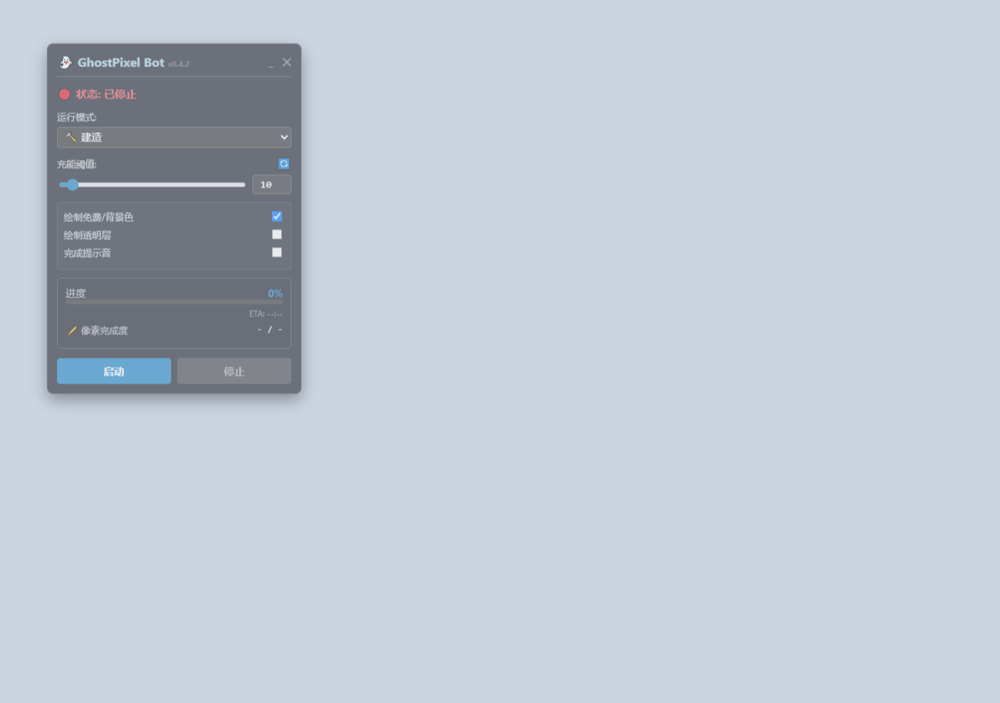
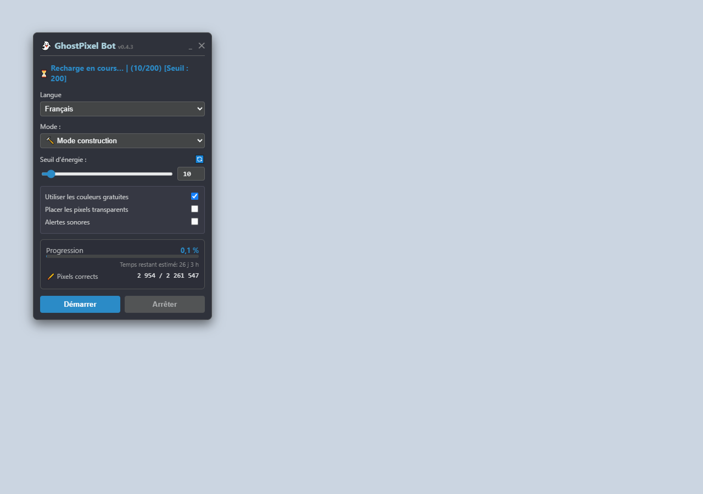
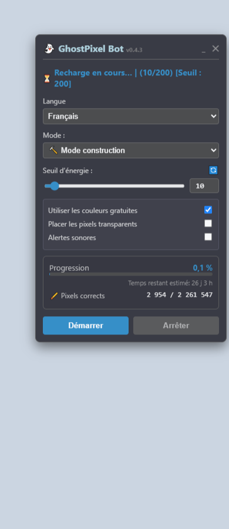

# feat(i18n): add complete French localization

## Motivation

The current 0.4.3 userscript mixes Chinese and English in its UI. French-speaking users need consistent labels, status messages, tooltips, notifications and statistics. The panel also currently says 0.4.2 although the userscript metadata says 0.4.3.

## Changes

- Centralize 63 translation entries with French, English fallback and preserved Chinese translations.
- Add a persistent language selector. Follow the browser locale on first use, falling back to English for unsupported locales.
- Translate the full panel, accessible names, dynamic states, completion notifications, known diagnostics and ETA units. Add French userscript description metadata.
- Format displayed numbers and percentages using the selected locale; keep CSS percentage values and ETA calculations unchanged.
- Read the displayed version from `GM_info.script.version`, retaining the official `@version 0.4.3`.
- Keep the original settings storage key and values. Store language separately. Add local-only tests and a documented optional personal French build.

## Before / after

Captured on a local fake page with synthetic data; these are **not** screenshots of a live GeoPixels session.

## Validation

- `npm run check`: JavaScript syntax check and 13 passing offline Node/jsdom tests.
- SHA-256 comparison: 26 protected declarations match upstream `efda7d87cadbb27954f58041d8bccbdf9fce20a2` byte-for-byte, including networking, authentication, pixel selection/ordering, energy rules, retries, start/stop and maintenance loops.
- Headless Edge on localhost: original panel plus French, English and Chinese; French at 390px; no detected text overflow, page errors or network calls.
- No automated placement, authentication, token or service tests performed. Actual Tampermonkey 5.5.1 validation remains for the user.

## Compatibility and scope

Existing settings remain intact, and language switching preserves DOM nodes and listeners. No additional automation is introduced. GPL-3.0 and original author attribution are retained. Known server payloads and raw diagnostic exception objects are not rewritten. This localization does not establish permission to use a bot on GeoPixels; current service rules prohibit automated painting.

The original metadata update/download URLs remain in the contribution source. A separately generated personal copy defaults to French and disables those updates; it is not committed as a second runtime artifact.

The existing completion-loop issue is intentionally outside this localization PR. No business-logic bug fix is included.

**Submission status:** proposal only. No branch pushed, no PR opened, no release published. Maintainer acceptance of this specific approach is not yet known.
